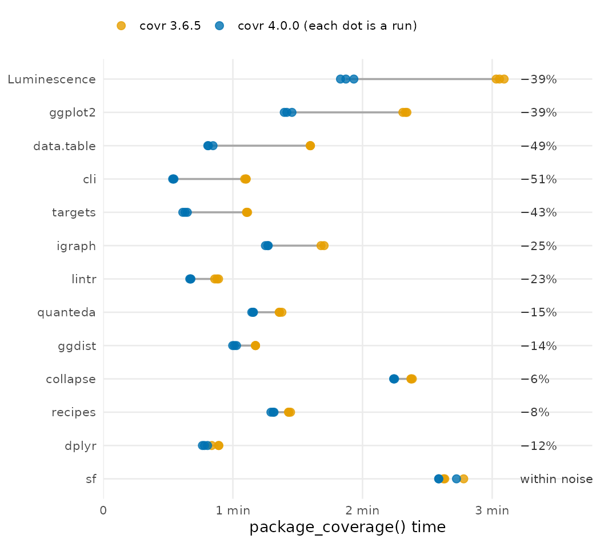

I'm excited to announce that [covr](https://covr.r-lib.org) 4.0.0 is now on
CRAN! covr tracks the test coverage of R packages, reporting which lines of
your R, C, C++ and now **Rust** code are run by your tests.

You can install it from CRAN with:

```r
install.packages("covr")
```

This is the first major release of covr since 2017, and by far the largest
since the original version: it has more than 80 entries in the change log and
96 merged pull requests, while no previous release had more than 15 entries or
22 pull requests. This post covers the
changes to how coverage is counted, the performance improvements,
experimental branch coverage, new kinds of code covr can measure, and new
tools for CI and pull requests. See the
[change log](https://covr.r-lib.org/news/index.html) for a full list of
changes and bug fixes.

## Breaking changes

### Coverage is counted more precisely

covr 4.0.0 counts coverage more consistently, so the same tests may report
slightly lower coverage. For most packages this is a small correction, but if
your CI enforces a coverage threshold, check the new numbers when you upgrade.

The main change is to `if` and `switch()` written without braces. Because of
the way R records source references, covr 3.6.5 gave each branch of an `if`
with braces its own counter, but treated an `if` without braces as a single
expression. Two functions that do the same thing, tested with `half(4)` and
`half_braces(4)`, got different results:

```r
half <- function(x) if (x > 0) x / 2 else 0
half_braces <- function(x) if (x > 0) { x / 2 } else { 0 }
```

| | covr 3.6.5 | covr 4.0.0 |
|---|---|---|
| `half()` | 100% | 0% |
| `half_braces()` | 0% | 0% |

covr 4.0.0 counts both the same way: the `else` branch never ran, and a line
only counts as covered when all of its expressions ran.

The other breaking changes are smaller:

* covr now requires R 4.0.0 or later.
* Line coverage is computed the same way by `print()`, `report()`, `codecov()`,
  `coveralls()` and the other outputs, which used to disagree slightly.
* S4 methods are named after their generic and signature, e.g.
  `show,MyClass-method`, so `function_exclusions` patterns that used the old
  names need updating.
* `codecov()` now fails if the upload fails, rather than silently passing.

See the [change log](https://covr.r-lib.org/news/index.html) for the rest.

## Faster

Three changes make covr 4.0.0 faster.

**Counting in C.** covr measures coverage by inserting a call to a counter
before every expression in your package (the
[How does covr work?](https://covr.r-lib.org/articles/how_it_works.html)
vignette describes this in detail). That counter was an R function, which
cost about 1.4 microseconds each time it ran. Luminescence's tests run about
20 million expressions, so this added almost 30 seconds. The counter is now a
call into C, which costs about 0.4 microseconds.

**Instrumenting once.** covr used to insert the counters each time an R
process loaded your package, and R then compiled the modified functions again
as they ran. covr now does this once, after installing the package, and
byte-compiles the result into the installed package. Luminescence now loads in
0.3 seconds rather than 4.6, which adds up for tests that start many R
processes, e.g. with callr or parallel workers.

**A text-based report.** `report()` used to build an htmltools tag for every
line of every file, a table row with several cells each. Luminescence has
66,000 lines of source, so that is hundreds of thousands of tags, and
rendering them to HTML one at a time took nearly all of the 4.5 minutes. The
report now builds each file's source table as text in a single vectorized
step, and only uses htmltools for the page around it.

To see what this adds up to, I ran the tests of 27 CRAN packages three times
each way: without coverage, and with `package_coverage()` from covr 3.6.5 and
4.0.0 (times exclude installing the package). For the packages that took
covr 3.6.5 between 30 seconds and 5 minutes:



The grey triangles are the tests without coverage, and the labels on the
right show what measuring coverage with covr 4.0.0 adds to that. For 10 of
these 13 packages that is now between 7% and 45%, where covr 3.6.5 often
doubled or tripled the time. data.table went from 2.4 minutes with covr 3.6.5
to 48 seconds, against 28 seconds without coverage (+70%). igraph and
collapse still take about twice as long; most of
their code is C and C++, which is compiled with coverage instrumentation and
without optimization.

The smaller packages take a few seconds either way (forcats 2 s without
coverage, 4 s with either covr; testthat 20 s, 27 s), and insight's long suite
goes from 671 s with covr 3.6.5 to 661 s, against 646 s without coverage.
(R 4.6.2 on Linux, on an otherwise idle machine. The full table, the
[scripts and raw results](https://github.com/r-lib/covr/tree/blog-post-benchmarks/blog/performance)
are in the covr repository.)

`report()` is faster for every package, by 6 to 230 times. For Luminescence
it went from 4.5 minutes to 1.2 seconds, and its peak memory from 1.2 GB to
310 MB. For igraph it took covr 3.6.5 more than an hour; 4.0.0 takes 10
seconds.

The functions you use after measuring coverage are faster too. `print()`,
`percent_coverage()` and `zero_coverage()` all go through `tally_coverage()`,
which is now more than ten times faster on large packages, and building the
upload for `codecov()` went from three seconds to a quarter of a second. On
Luminescence (median of `bench::mark()` runs):

| Function | covr 3.6.5 | covr 4.0.0 |
|---|---|---|
| `tally_coverage()` | 2.3 s | 0.20 s |
| `percent_coverage()` | 2.4 s | 0.19 s |
| `zero_coverage()` | 2.4 s | 0.18 s |
| `print()` | 2.8 s | 0.23 s |
| `codecov()`, building the upload | 3.2 s | 0.26 s |
| `cobertura()` | 10.0 s | 8.0 s |
| `sonarqube()` | 6.1 s | 3.5 s |

<!-- TODO before publishing: rerun bench-post.R after #755 (Cobertura and
SonarQube) merges, update the last two rows, and add the median across all
packages from ~/covr-bench/cov. -->

### Tests that start other R processes

Every R process that loads your package, such as a callr session, a future
worker or a Shiny app started by the tests, saves its own coverage when it
exits, and covr adds these together at the end. covr 3.6.5 read every one of
these files into memory before adding them up, and each held a full copy of
the package's counters. For packages whose tests start hundreds of processes,
this could fail at the very end of a long run.

[languageserver](https://github.com/REditorSupport/languageserver) is an
extreme case: its tests start 177 language servers and about 830 R processes
in total. Its maintainers had split their coverage job across 8 parallel CI
jobs to keep it manageable.

| languageserver | Tests | Coverage files | Merging them |
|---|---|---|---|
| Without coverage | 9 min | — | — |
| covr 3.6.5 | 80 min | 5.2 GB | runs out of memory |
| covr 4.0.0 | 13 min | 8 MB | 1 s, 144 MB |

covr 4.0.0 also writes these files atomically, so a process killed at the end
of the tests no longer leaves a truncated file that makes the whole run fail
with `error reading from connection`. covr 3.6.5 failed this way on the tests
of mlr3 and future; 4.0.0 measures them and warns about how many processes'
coverage was lost.

## Branch coverage

Line coverage tells you a line ran; it does not tell you whether both sides of
an `if` on that line ran. covr 4.0.0 can now record this, with
`options(covr.branch_coverage = TRUE)`. Take these two functions in a
package:

```r
clamp <- function(x, lo = 0, hi = 1) {
  if (x < lo) return(lo)
  if (x > hi) return(hi)
  x
}

half <- function(x) if (x > 0) x / 2 else 0
```

whose tests call `clamp(0.5)`, `clamp(2)` and `half(4)`:

```r
options(covr.branch_coverage = TRUE)
cov <- package_coverage()

percent_coverage(cov, by = "branch")
#> [1] 66.66667

tally_coverage(cov, by = "branch")
#>   functions line column branch label value
#> 1     clamp    2      3      1  TRUE     0
#> 2     clamp    2      3      2 FALSE     2
#> 3     clamp    3      3      1  TRUE     1
#> 4     clamp    3      3      2 FALSE     1
#> 5      half    7     21      1  TRUE     1
#> 6      half    7     21      2 FALSE     0
```

(The `filename` column is left out.) No test makes `x` negative, so the first
`if` in `clamp()` never took its `TRUE` branch, and `half()` never took its
`else`.

Each `if` has a `TRUE` and a `FALSE` branch, including an `if` without an
`else`, and each `switch()` has a branch for each of its arms. `to_lcov()`,
`to_cobertura()`, `codecov()` and `coveralls()` include the branches, so
Codecov and Coveralls show partly covered lines. `report()` does not show
branches yet.

Branch coverage is off by default and experimental, so what counts as a
branch and how branches are stored may still change. Without the option covr
instruments your code as before. See
[`?covr.branch_coverage`](https://covr.r-lib.org/reference/covr.branch_coverage.html)
for the details.

## Measuring more code

### Rust

`package_coverage()` now measures the Rust code of packages built with
[extendr](https://extendr.github.io/) or
[savvy](https://github.com/yutannihilation/savvy), using LLVM's source-based
coverage. It needs the llvm tools of your Rust toolchain, which you can
install with `rustup component add llvm-tools`.

### Shiny apps

[`shiny_app_coverage()`](https://covr.r-lib.org/reference/shiny_app_coverage.html)
measures the coverage of a Shiny app that is not part of a package while its
[shinytest2](https://rstudio.github.io/shinytest2/) tests run, including the
code the app runs in the R processes shinytest2 starts. The new
[Shiny vignette](https://covr.r-lib.org/articles/shiny.html) also covers apps
in packages.

### Compiled code in the file you are working on

`file_coverage()` now works with the C, C++ and Fortran code of a package
(not Rust yet). From the package directory, run the tests that exercise a C
file with:

```r
file_coverage("src/foo.c", "tests/testthat/test-foo.R")
```

It loads the package with `pkgload::load_all()` and only recompiles the files
that changed, so it is much faster than `package_coverage()`. This also means
`devtools::test_coverage_active_file()` now works for C, C++ and Fortran files.

covr can also now measure the coverage of installed packages, functions
stored in lists or created with `local()` (with
`Config/covr/full_traversal: true` in your DESCRIPTION), code run by
`parallel::mclapply()` in `file_coverage()`, and the property callbacks of S7
classes.

## Reports

`report()` has been rewritten. It no longer depends on DT, jQuery or
Bootstrap, lists the least covered files first, keeps the Files and Source
tabs in view as you scroll, and follows your browser's dark mode. Here is the
report for forcats, made with covr 4.0.0; click a file to see its source, or
use the button in the corner to switch themes:

<iframe src="/reports/covr-4-0-0-forcats/" title="covr report for forcats" style="width: 100%; height: 600px; border: 1px solid #ddd; border-radius: 4px;" loading="lazy"></iframe>

([Open it in a new tab](/reports/covr-4-0-0-forcats/).) If green
and red are hard for you to tell apart, you can set other colors for the
report and the console:

```r
options(covr.report_colors = c(covered = "#0072B2", missed = "#E69F00"))
```

The new [`report_html()`](https://covr.r-lib.org/reference/report_html.html)
returns the report as HTML so it can be embedded in an R Markdown or Quarto
document.

## CI and pull requests

### Badges without a coverage service

[`to_badge()`](https://covr.r-lib.org/reference/to_badge.html) writes an SVG
coverage badge. covr includes a GitHub Actions workflow that publishes the
badge on every push, so your README can show coverage without uploading it to
Codecov or Coveralls. Copy
`system.file("workflows", "test-coverage-badge.yaml", package = "covr")` to
`.github/workflows/` to use it.

### Coverage services and formats

`codecov()` now uses Codecov's current upload API, which supports
organization-level tokens, and `coveralls()` now detects GitHub Actions rather
than assuming Travis CI. The new `to_lcov()` writes an LCOV file for `genhtml`
and other tools, and `coverage_to_markdown()` formats coverage as a Markdown
table for GitHub Actions job summaries or pull request comments.

There are also new tools for finding missed lines and functions, listing
which tests ran each line, combining coverage from several runs and keeping
coverage when a test fails; see the
[change log](https://covr.r-lib.org/news/index.html) for these and the many
bug fixes in this release.

## Eleven years of covr

I [first released covr](/post/2015-05-20-covr/) in May 2015, when R had few
tools for measuring test coverage. Today 2,333 CRAN packages list
covr in Suggests, and about
[28,000 `DESCRIPTION` files on GitHub](https://github.com/search?q=covr+path%3ADESCRIPTION&type=code)
mention it. Thank you to everyone who has used covr over the years and
reported the problems that shaped this release; many of the issues fixed in
4.0.0 were opened years ago by people who took the time to describe what they
needed.

## Acknowledgements

Thank you to the 19 contributors who made this release possible by opening
issues or submitting pull requests:

[&#x0040;amaltawfik](https://github.com/amaltawfik),
[&#x0040;amar-v1](https://github.com/amar-v1),
[&#x0040;Bisaloo](https://github.com/Bisaloo),
[&#x0040;BjarkeHautop](https://github.com/BjarkeHautop),
[&#x0040;DSGeoff](https://github.com/DSGeoff),
[&#x0040;erkurtharun](https://github.com/erkurtharun),
[&#x0040;gergness](https://github.com/gergness),
[&#x0040;gowerc](https://github.com/gowerc),
[&#x0040;hadley](https://github.com/hadley),
[&#x0040;JohannesFriedrich](https://github.com/JohannesFriedrich),
[&#x0040;katrinabrock](https://github.com/katrinabrock),
[&#x0040;kbodwin](https://github.com/kbodwin),
[&#x0040;llrs-roche](https://github.com/llrs-roche),
[&#x0040;maksymiuks](https://github.com/maksymiuks),
[&#x0040;MichaelChirico](https://github.com/MichaelChirico),
[&#x0040;mpadge](https://github.com/mpadge),
[&#x0040;olivroy](https://github.com/olivroy),
[&#x0040;roaldarbol](https://github.com/roaldarbol), and
[&#x0040;t-kalinowski](https://github.com/t-kalinowski).

---

Starting in 2027 I'll be taking on consulting work for the first time, on R
package development, testing and performance. If covr, or any of the other
packages I've worked on, is part of something you're building, email me at
[james.f.hester@gmail.com](mailto:james.f.hester@gmail.com).
