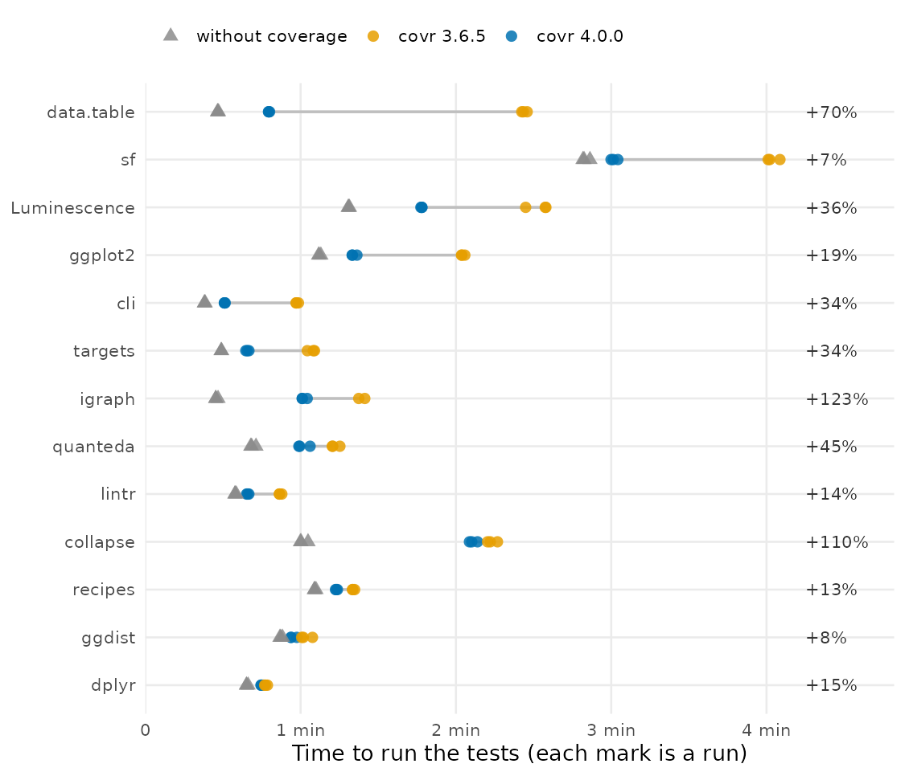

I'm very excited to announce that [covr](https://covr.r-lib.org) 4.0.0 is now
on CRAN! covr tracks the test coverage of the R, C, C++, Fortran and now
**Rust** code in your R packages, R scripts and **Shiny apps**.

You can install it from CRAN with:

```r
install.packages("covr")
```

Test coverage tells you how much of your code runs when you run your tests,
which helps you find the paths your tests never check. A package with 100%
coverage can certainly still have bugs, but coverage is a valuable tool both
while you develop a package and when you review a package to decide whether
to depend on it.

Since the first CRAN release in May 2015, covr has become the standard tool
for test coverage in R. 2,345 CRAN packages list it in their `DESCRIPTION`,
and it is mentioned in more than 25,000 `DESCRIPTION` files on GitHub.

This is by far the largest release of covr since that first one. It closes 99
issues with 112 pull requests, which change about 12,000 lines of R and C code
and add 15,000 lines of tests. Much of this work went into making covr faster
and into measuring new kinds of code, including Rust code and Shiny apps. See
the [change log](https://covr.r-lib.org/news/index.html) for a full list of
changes.

## Breaking changes

Coverage is now counted more precisely, so the coverage reported for your
package may be slightly higher or lower than with the previous release. In
particular, because of the way R adds source references to expressions, covr
treated an `if` differently depending on whether its branches had braces. Take
two functions that do the same thing, tested with `half(4)` and
`half_braces(4)`:

```r
half <- function(x) if (x > 0) x / 2 else 0
half_braces <- function(x) if (x > 0) { x / 2 } else { 0 }
```

| | covr 3.6.5 | covr 4.0.0 |
|---|---|---|
| `half()` | 100% | 0% |
| `half_braces()` | 0% | 0% |

covr 3.6.5 gave the branches of `half_braces()` their own counters, but
counted all of `half()` as one expression, so the `else` that never ran was
reported as covered. covr 4.0.0 counts both the same way. The new behavior is
more correct, and for most packages it makes only a small difference to the
coverage. It also means you can write your code in whichever style you prefer
without it changing the coverage covr reports.

The other breaking changes are smaller. covr now requires R 4.1.0 or later.
All of the outputs now calculate line coverage the same way; previously they
could disagree slightly. S4 methods have more precise names, such as
`show,MyClass-method`, so you may need to update your `function_exclusions`.

[`codecov()`](https://covr.r-lib.org/reference/codecov.html) now signals an
error when an upload fails, so your CI fails instead of silently passing. Rate
limits and Codecov outages still only give a warning. Finally,
[`to_cobertura()`](https://covr.r-lib.org/reference/covr-deprecated.html) and
[`to_sonarqube()`](https://covr.r-lib.org/reference/covr-deprecated.html) are
deprecated in favor of
[`cobertura()`](https://covr.r-lib.org/reference/cobertura.html) and
[`sonarqube()`](https://covr.r-lib.org/reference/sonarqube.html).

## Improved performance

Previous versions of covr counted which expressions ran by adding calls to a
small R function throughout your code, which kept the counts in an R
environment. covr 4.0.0 uses a counter written in C instead, which uses less
memory and takes about 0.4 microseconds per counted expression, rather than
1.3–1.4 microseconds.

We also changed when covr adds these counters. It used to add them each time
an R process loaded your package, and R then had to compile the modified
functions again as they ran. covr 4.0.0 adds the counters and byte-compiles
the package once, when [`package_coverage()`](https://covr.r-lib.org/reference/package_coverage.html) installs it, so each process that
loads the package starts faster (0.3 seconds rather than 4.6 for
[*Luminescence*](https://r-lum.github.io/Luminescence)).

Together, these changes make measuring coverage faster, sometimes much faster.
This plot shows the time to run the tests of a selection of packages without
coverage (grey), with covr 3.6.5 (orange) and with covr 4.0.0 (blue). The
labels show how much covr 4.0.0 adds to the time without coverage:



For 10 of these 13 packages, measuring coverage with covr 4.0.0 adds between
7% and 45% to the time of the tests, where covr 3.6.5 often doubled or tripled
it. [*data.table*](https://r-datatable.com), for example, went from 2.4
minutes with covr 3.6.5 to 48 seconds, against 28 seconds without coverage.

Packages with shorter tests gained less. Of the 10 packages I measured whose
tests take less than 30 seconds with coverage, all were within 7% of covr
3.6.5, except [*posterior*](https://mc-stan.org/posterior) and
[*roxygen2*](https://roxygen2.r-lib.org), which were 23% and 16% faster.

These timings exclude installing the package, and were measured with R 4.6.2
on Linux. The
[scripts and full results](https://github.com/r-lib/covr/tree/blog-post-benchmarks/blog/performance)
are in the covr repository.

We also spent time improving the functions you run after coverage is
measured, in particular [`report()`](https://covr.r-lib.org/reference/report.html), which creates an HTML report of the
coverage. Previous versions of `report()` built the table of each file
iteratively, by repeatedly calling into
[*htmltools*](https://rstudio.github.io/htmltools) for every line. covr 4.0.0
writes the table directly as HTML, which is 6 to 230 times faster on the
packages I measured. For *Luminescence*, `report()` went from 4.5 minutes to
1.2 seconds, and its peak memory from 1.2 GB to 310 MB. For
[*igraph*](https://r.igraph.org), covr 3.6.5's `report()` had not finished
after nearly an hour; covr 4.0.0 takes 10 seconds.

Other functions that summarize or export coverage are also faster. Across 23
packages, the median speedup ranges from about 6 times for
[`tally_coverage()`](https://covr.r-lib.org/reference/tally_coverage.html),
[`percent_coverage()`](https://covr.r-lib.org/reference/percent_coverage.html)
and `codecov()` to 16–20 times for `sonarqube()` and `cobertura()`, with
[`print()`](https://covr.r-lib.org/reference/print.coverage.html) in between
at 9 times.

Another major area of improvement is measuring the coverage of tests that
start other R processes. covr has been able to measure the coverage of these
processes for a long time, but it merged their coverage in memory, and slowly.
For packages whose tests start hundreds or thousands of R processes, such as
[*languageserver*](https://github.com/REditorSupport/languageserver), this
slowed things down considerably: its tests took 9 minutes without coverage,
but 80 minutes with covr 3.6.5, and covr then ran out of memory adding up the
coverage of the 1,000 processes, needing more than 7 GB. With covr 4.0.0 the
tests finish in about 13 minutes, and adding up their coverage takes a
second and 144 MB. We have also made writing the coverage of these processes more
robust, so packages whose coverage used to fail, such as
[*mlr3*](https://mlr3.mlr-org.com) and
[*future*](https://future.futureverse.org), now work:

| Package | Without coverage | covr 3.6.5 | covr 4.0.0 |
|---|---|---|---|
| *mlr3* | 177 s | fails after 673 s | 247 s (+40%) |
| *future* | 230 s | fails after 1,176 s | 281 s (+22%) |

(With covr 4.0.0, the tests of *future* also needed a
[small fix](https://github.com/futureverse/future/pull/850) to a test that
relied on how covr 3.6.5 set up the library paths of R processes.)

## Branch coverage

One of the longest-standing open issues in covr, opened in
[August 2017](https://github.com/r-lib/covr/issues/279), was branch coverage.
Branch coverage tracks which branches of each conditional were taken, such as
the `TRUE` and `FALSE` cases of an `if`. Line coverage tells you whether the
code on a line ran, but not which way each `if` went, including the `FALSE`
case of an `if` without an `else`, which runs no code at all. covr 4.0.0 can
now measure branch coverage, with the experimental
`options(covr.branch_coverage = TRUE)`. Take these two functions in a package:

```r
clamp <- function(x, lo = 0, hi = 1) {
  if (x < lo) return(lo)
  if (x > hi) return(hi)
  x
}

half <- function(x) if (x > 0) x / 2 else 0
```

whose tests call `clamp(0.5)`, `clamp(2)` and `half(4)`:

```r
options(covr.branch_coverage = TRUE)
cov <- package_coverage()

tally_coverage(cov, by = "branch")
#>   functions line column branch label value
#> 1     clamp    2      3      1  TRUE     0
#> 2     clamp    2      3      2 FALSE     2
#> 3     clamp    3      3      1  TRUE     1
#> 4     clamp    3      3      2 FALSE     1
#> 5      half    7     21      1  TRUE     1
#> 6      half    7     21      2 FALSE     0
```

No test makes `x` negative, so the first `if` in `clamp()` never took its
`TRUE` branch, and the `else` in `half()` was never taken either. (The
`filename` column is left out of the output above.)

`print(cov, missing = TRUE)` and `report()` also show branch coverage. In the
report, a line is marked as partly covered if one of its branches was never
taken. Branch coverage is also included in the output of
[`lcov()`](https://covr.r-lib.org/reference/lcov.html), `cobertura()`,
`codecov()` and
[`coveralls()`](https://covr.r-lib.org/reference/coveralls.html).

Branch coverage is off by default and still experimental, so what counts as a
branch may change. See
[`?covr.branch_coverage`](https://covr.r-lib.org/reference/covr.branch_coverage.html)
for the details.

## Rust

covr has long measured the coverage of C, C++ and Fortran code in packages,
and covr 4.0.0 extends this to Rust. It works with packages built with
[*extendr*](https://extendr.github.io/) or
[*savvy*](https://github.com/yutannihilation/savvy), or with any other setup
that builds Rust code with cargo.

Rust coverage uses LLVM's source-based coverage tools. Install them for your
Rust toolchain with `rustup component add llvm-tools`, and
`package_coverage()` then includes your Rust code with no other changes. For
example, here is the coverage of the [*b64*](https://github.com/extendr/b64)
package, whose report is shown [below](#improved-reports):

```r
package_coverage("b64")
#> b64 Coverage: 22.18%
#> R/config.R: 0.00%
#> R/engine.R: 17.65%
#> src/rust/src/lib.rs: 18.46%
#> R/encode.R: 31.58%
#> R/extendr-wrappers.R: 35.29%
#> R/alphabet.R: 57.14%
#> src/entrypoint.c: 100.00%
```

Rust coverage isn't measured on Windows yet.

The number of CRAN packages with Rust code is still relatively small, about
95 today, but I expect it to keep growing, and I hope being able to measure
the coverage of your Rust code makes using it in your packages more
appealing.

## Shiny apps

covr could technically measure the coverage of Shiny apps for a long time; I
made a proof of concept as far back as 2017. But it was difficult to set up,
because the code of a Shiny app runs in a separate R process. In addition,
many Shiny apps are not part of a package, so they did not fit into covr's
existing functions.

For Shiny apps in a package, `package_coverage()` now includes the app code
run by [*shinytest2*](https://rstudio.github.io/shinytest2/) tests. For apps
outside a package, the new
[`shiny_app_coverage()`](https://covr.r-lib.org/reference/shiny_app_coverage.html)
runs your *shinytest2* tests and reports the coverage of the app.

For example, take this small app in `app/app.R`, which describes the number
you enter:

```r
library(shiny)

ui <- fluidPage(
  numericInput("n", "Pick a number", value = 1),
  textOutput("size")
)

describe <- function(n) {
  if (is.na(n)) {
    "not a number"
  } else if (n < 0) {
    "negative"
  } else if (n %% 2 == 0) {
    "even"
  } else {
    "odd"
  }
}

server <- function(input, output, session) {
  output$size <- renderText(describe(input$n))
}

shinyApp(ui, server)
```

and its *shinytest2* test in `app/tests/testthat/test-app.R`:

```r
test_that("the app describes even numbers", {
  app <- shinytest2::AppDriver$new()
  app$set_inputs(n = 4)
  expect_equal(app$get_value(output = "size"), "even")
  app$stop()
})
```

`shiny_app_coverage()` runs the test, which starts the app in another R
process, and returns the coverage of the code the app ran. *shinytest2* skips
its tests on CRAN, so set `NOT_CRAN` when running them
yourself:

```r
Sys.setenv(NOT_CRAN = "true")
app_cov <- shiny_app_coverage("app")
#> [ FAIL 0 | WARN 0 | SKIP 0 | PASS 1 ]

print(app_cov, missing = TRUE)
#> Coverage: 75.00%
#> app.R: 75.00%  missed 10, 12
```

The app ran `describe()` twice, once for the starting value of 1 and once for
4, so the "odd" and "even" lines are covered, but nothing tested a missing or
negative number (lines 10 and 12). See the
[Shiny vignette](https://covr.r-lib.org/articles/shiny.html) for more details,
including apps in packages.

## Additional features

[`file_coverage()`](https://covr.r-lib.org/reference/file_coverage.html) and
[*devtools*](https://devtools.r-lib.org)' [`test_coverage_active_file()`](https://devtools.r-lib.org/reference/test.html) now
work for C, C++, Fortran and Rust code as well as R code. They load the
package with [`pkgload::load_all()`](https://pkgload.r-lib.org/reference/load_all.html) and build an instrumented copy of it,
recompiling only the files that changed since the last run, so you get a
tight development cycle and can work on compiled code the same way as on R
code:

```r
file_coverage("src/foo.c", "tests/testthat/test-foo.R")
```

Another long-standing open issue, from
[2015](https://github.com/r-lib/covr/issues/113), was that functions stored
inside lists and other objects, such as the methods of ggproto objects, could
not be traced. They now can, if you add `Config/covr/full_traversal: true` to
your `DESCRIPTION`.

## Improved reports

Apart from being much faster, `report()` no longer needs
[*DT*](https://rstudio.github.io/DT/), jQuery or Bootstrap. It lists the least
covered files first, keeps the Files and Source tabs at the top as you
scroll, and has a new dark mode.

The default colors are green and red, which are hard to tell apart for people
with red-green color blindness. You can now choose other colors for the report
and the console, including a colorblind-friendly palette based on Okabe-Ito:

```r
options(covr.report_colors = covr::colorblind_palette)
```

The new [`report_html()`](https://covr.r-lib.org/reference/report_html.html)
returns the report as HTML, so you can embed it in R Markdown or Quarto
documents. Here is the report for *b64*, a small package that uses Rust
through *extendr*, measured with branch coverage and the colorblind palette.
Click `src/rust/src/lib.rs` to see the coverage of its Rust code, or use the
button in the corner to switch to the dark theme:

<iframe src="/reports/covr-4-0-0-b64/" title="covr report for b64" style="width: 100%; height: 600px; border: 1px solid #ddd; border-radius: 4px;" loading="lazy"></iframe>

([Open it in a new tab](/reports/covr-4-0-0-b64/).)

## CI and pull requests

The new [`badge()`](https://covr.r-lib.org/reference/badge.html) writes an
SVG coverage badge, so you can show your coverage in your README without
relying on an external service like Codecov or Coveralls. covr includes an
example GitHub Actions workflow that publishes it.

For packages that do use those services, `codecov()` now uses Codecov's
current upload API, and `coveralls()` detects the CI service, so it now works
natively on GitHub Actions.

`lcov()` writes coverage in the popular
[LCOV](https://github.com/linux-test-project/lcov) format, and
[`coverage_to_markdown()`](https://covr.r-lib.org/reference/coverage_to_markdown.html) creates a Markdown table of your coverage, e.g. for a
GitHub Actions job summary or a pull request comment.

For use locally or by coding agents, `print(cov, missing = TRUE)` and
[`annotate_coverage()`](https://covr.r-lib.org/reference/annotate_coverage.html) show the lines your tests missed as plain text. For the
functions in the [branch coverage](#branch-coverage) example:

```r
annotate_coverage(cov)
#> R/clamp.R
#>   1 |      | clamp <- function(x, lo = 0, hi = 1) {
#>   2 |  !!0 |   if (x < lo) return(lo)  <- not taken: TRUE
#>   3 |    1 |   if (x > hi) return(hi)
#>   4 |    1 |   x
#>   5 |      | }
#>   6 |      |
#>   7 |  !!0 | half <- function(x) if (x > 0) x / 2 else 0  <- not taken: FALSE
```

Finally, [`c()`](https://covr.r-lib.org/reference/c.coverage.html) now combines coverage from separate runs, such as tests run in
several CI jobs, without any additional code.

## Thanks

The first commit of covr was on December 19th, 2014, when my oldest daughter
was only 4 months old. She is now almost 12 and a half, and it is amazing to
look back at how she has grown, and how the community and the use of covr have
grown in the nearly 12 years since that first commit. Thank you for being part
of the R community and for your interest in covr; I hope this release makes it
an even stronger choice for your package development.

Thank you to the 70 contributors who made this release possible by opening
issues or submitting pull requests:

[&#x0040;Ahill25](https://github.com/Ahill25),
[&#x0040;akersting](https://github.com/akersting),
[&#x0040;al-obrien](https://github.com/al-obrien),
[&#x0040;ALanguillaume](https://github.com/ALanguillaume),
[&#x0040;amaltawfik](https://github.com/amaltawfik),
[&#x0040;amar-v1](https://github.com/amar-v1),
[&#x0040;B0ydT](https://github.com/B0ydT),
[&#x0040;bestdan](https://github.com/bestdan),
[&#x0040;billdenney](https://github.com/billdenney),
[&#x0040;Bisaloo](https://github.com/Bisaloo),
[&#x0040;BjarkeHautop](https://github.com/BjarkeHautop),
[&#x0040;brodieG](https://github.com/brodieG),
[&#x0040;cjyetman](https://github.com/cjyetman),
[&#x0040;daattali](https://github.com/daattali),
[&#x0040;dblodgett-usgs](https://github.com/dblodgett-usgs),
[&#x0040;dgkf](https://github.com/dgkf),
[&#x0040;dmurdoch](https://github.com/dmurdoch),
[&#x0040;DSGeoff](https://github.com/DSGeoff),
[&#x0040;erkurtharun](https://github.com/erkurtharun),
[&#x0040;fangly](https://github.com/fangly),
[&#x0040;frederikfabriciusbjerre](https://github.com/frederikfabriciusbjerre),
[&#x0040;gergness](https://github.com/gergness),
[&#x0040;gowerc](https://github.com/gowerc),
[&#x0040;hadley](https://github.com/hadley),
[&#x0040;hsloot](https://github.com/hsloot),
[&#x0040;IndrajeetPatil](https://github.com/IndrajeetPatil),
[&#x0040;jd4ds](https://github.com/jd4ds),
[&#x0040;jessekps](https://github.com/jessekps),
[&#x0040;JohannesFriedrich](https://github.com/JohannesFriedrich),
[&#x0040;jonthegeek](https://github.com/jonthegeek),
[&#x0040;josherrickson](https://github.com/josherrickson),
[&#x0040;JT-39](https://github.com/JT-39),
[&#x0040;katrinabrock](https://github.com/katrinabrock),
[&#x0040;kbodwin](https://github.com/kbodwin),
[&#x0040;kevinushey](https://github.com/kevinushey),
[&#x0040;kforner](https://github.com/kforner),
[&#x0040;king-of-poppk](https://github.com/king-of-poppk),
[&#x0040;kongdd](https://github.com/kongdd),
[&#x0040;krlmlr](https://github.com/krlmlr),
[&#x0040;liu1029](https://github.com/liu1029),
[&#x0040;llrs-roche](https://github.com/llrs-roche),
[&#x0040;maksymiuks](https://github.com/maksymiuks),
[&#x0040;MichaelChirico](https://github.com/MichaelChirico),
[&#x0040;michaelquinn32](https://github.com/michaelquinn32),
[&#x0040;mjakubczak](https://github.com/mjakubczak),
[&#x0040;mjfrigaard](https://github.com/mjfrigaard),
[&#x0040;MLopez-Ibanez](https://github.com/MLopez-Ibanez),
[&#x0040;moodymudskipper](https://github.com/moodymudskipper),
[&#x0040;mpadge](https://github.com/mpadge),
[&#x0040;Naikless](https://github.com/Naikless),
[&#x0040;nicholascarey](https://github.com/nicholascarey),
[&#x0040;noamross](https://github.com/noamross),
[&#x0040;ocschwar](https://github.com/ocschwar),
[&#x0040;olivroy](https://github.com/olivroy),
[&#x0040;pdbailey0](https://github.com/pdbailey0),
[&#x0040;roaldarbol](https://github.com/roaldarbol),
[&#x0040;schaffstein](https://github.com/schaffstein),
[&#x0040;sclewis23](https://github.com/sclewis23),
[&#x0040;SebKrantz](https://github.com/SebKrantz),
[&#x0040;stla](https://github.com/stla),
[&#x0040;StuartWheater](https://github.com/StuartWheater),
[&#x0040;t-kalinowski](https://github.com/t-kalinowski),
[&#x0040;tdhock](https://github.com/tdhock),
[&#x0040;thierrymoudiki](https://github.com/thierrymoudiki),
[&#x0040;thomasrockhu](https://github.com/thomasrockhu),
[&#x0040;vjcitn](https://github.com/vjcitn),
[&#x0040;wkdavis](https://github.com/wkdavis),
[&#x0040;wolski](https://github.com/wolski),
[&#x0040;xec-cm](https://github.com/xec-cm),
and [&#x0040;zhuxr11](https://github.com/zhuxr11).

---

Starting in 2027 I'll be doing consulting for the first time, on R package
development, testing and performance. If you have projects you think I would
be a good fit for, I'd love to hear about them; please write to me at
[james.f.hester@gmail.com](mailto:james.f.hester@gmail.com).
